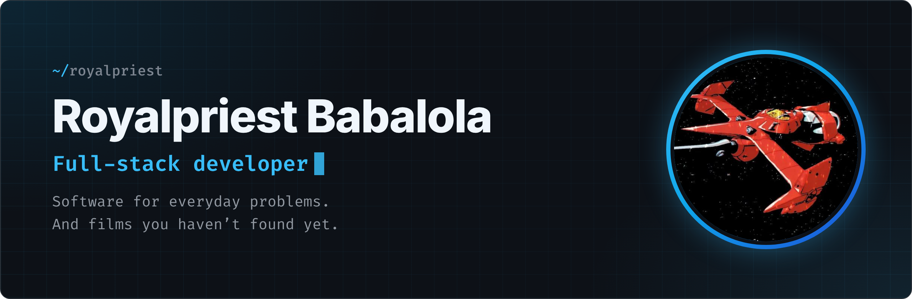

Most of what I make starts with a small annoyance: a movie night with no pick, a list of shows scattered across apps, a spreadsheet nobody trusts. I like turning those into things people actually open, then making them fast and dependable.

🔒 <i>Several of my projects live in private repositories. Live demos are linked below, and I'm happy to walk through any of the code.</i>

---

## 🚀 Things I've Built

| Project | What it does | Stack |
|:--|:--|:--|
|  | For nights when you know the mood but not the movie. Type “cozy but a little sad” and get real films, each with a one-line case for watching it. |      |
|  | One shelf for everything you watch, read and play, so “what was that show again?” always has an answer. On your phone and the web. |      |
|  | Baseball stats for fans who don’t speak sabermetrics. Look up a player, compare two side by side, and see what the numbers actually mean. |      |
|  | Drop in a messy bookings spreadsheet, get back a dashboard you can trust: bad rows flagged with a reason, totals right to the cent. |    |
|    | Turn a long stream into captioned Shorts without uploading a thing. Small apps snap together like Unix pipes, all on your own machine. |    |
|    | How far did each player actually run? Worked out from ordinary TV footage, no tracking vests or stadium cameras. |    |

---

## 💼 Experience

| Role | What I did | Stack |
|:--|:--|:--|
|   Jan – Apr 2026 | Spent four months building the tools a manufacturer’s teams use every day, from the forms staff fill in to the reports each team uses to track its numbers. |     |

---

## 🛠️ What I Work With

| Area | Stack |
|:--|:--|
| **Frontend** |      |
| **Backend &amp; Databases** |         |
| **AI &amp; Data** |     |
| **Tools &amp; Cloud** |      |
| **Other** |     |

---

Thanks for stopping by ✨

